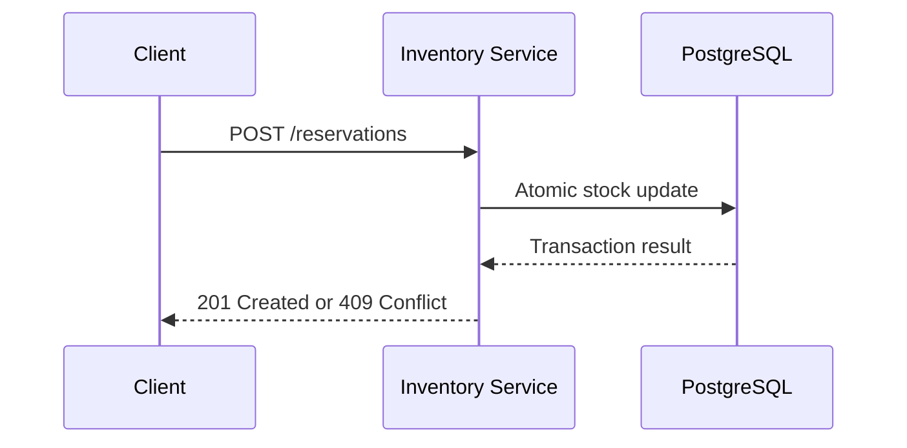
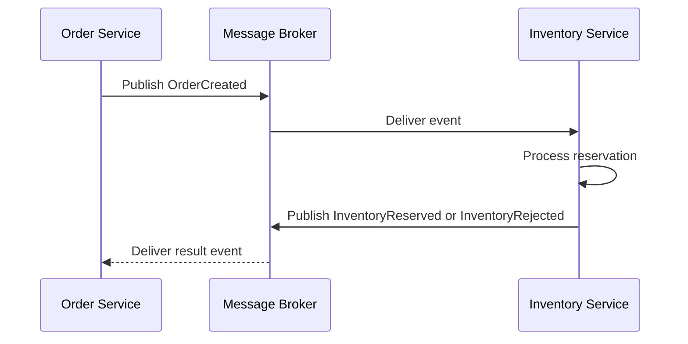

# Inventory reservation management

Live coding challeng for a company abroad. The main ideia is to handle concurrency and software architecture while coding. No agents, no LLMS, just coding and documentation.

## Core domain business logic

handle products and reservations. An ecommerce has faced overselling during his for sale prices and the concurrency problems has been leading the stock to updates without adequate coordination, allowing the same request to claim the same stock.

Currently the project is a modular monolith that is breaking into microservices, our task is to create a boundary that will be consumed by another service. Here the critical mechanism is to enforce inventory consistency, through transactions, conditional updates or appropriate locking. So let's move on to the next topic

## Main goals here

- Atomic operations
- inventory consistency
- Handle multiple requests at once
- Handle concurrency created by multiple requests that services made

## Responsability

Ok, since we know that we need to handle a part of a service that handle multiple requests, deal with concurrency practically at all the time whe need to understand all the flow and how an microservice, event based works behind the scenes. Below, with mermaid, I'll give you an short example with a lot informations.

### Interview basic workflow

----

### Expanded pourpose

----

## Software development principles used into this interview project

| Concept | Purpose | Why It Matters |
| --- | --- | --- |
| **Database Transactions (ACID)** | Groups related database operations into a consistent unit of work. | Prevents partial inventory updates and preserves data integrity. |
| **Concurrency Control** | Coordinates simultaneous operations on shared inventory. | Prevents conflicting requests from reserving more stock than is available. |
| **Atomic Updates** | Executes inventory changes as indivisible database operations. | Ensures stock validation and decrementing cannot be separated by competing requests. |
| **Input Validation** | Validates request payloads and business constraints. | Rejects invalid product identifiers, quantities, and malformed requests. |
| **Error Handling** | Standardizes failures and HTTP responses. | Makes the API predictable for clients and easier to debug. |
| **Unit Testing** | Tests isolated business rules and service behavior. | Detects defects in reservation logic and validation. |
| **Integration Testing** | Tests interactions with the real database and API. | Verifies transactional behavior and concurrency guarantees. |
| **Docker** | Packages the application and its dependencies. | Improves environment consistency across development and deployment. |
| **CI Pipeline** | Automates linting, testing, and quality checks. | Prevents defective changes from progressing through the delivery process. |

## Attention ⚠️⚠️⚠️

The commits created during the exam has the emoji: 🔖 and the main goal was only a RESTful api, but then my goal is to learn and create an entire microservice application with simple examples.
